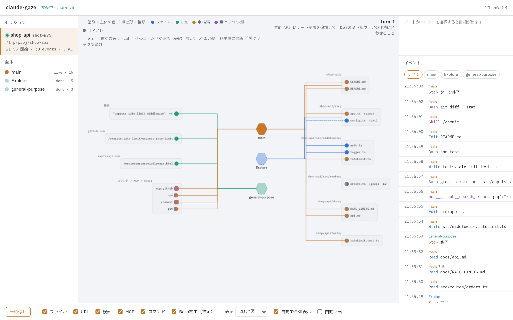
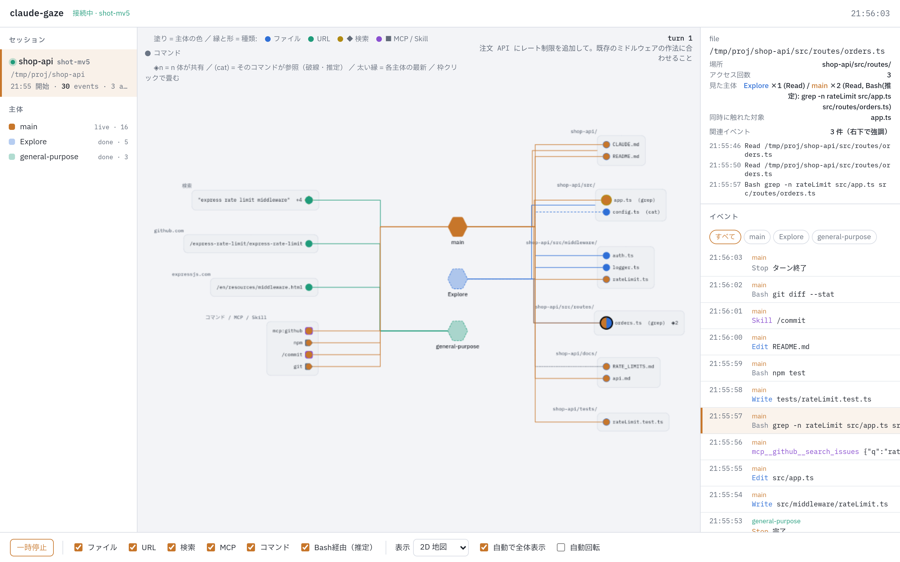
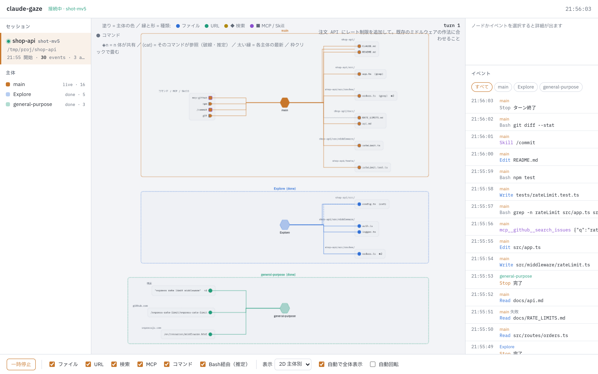
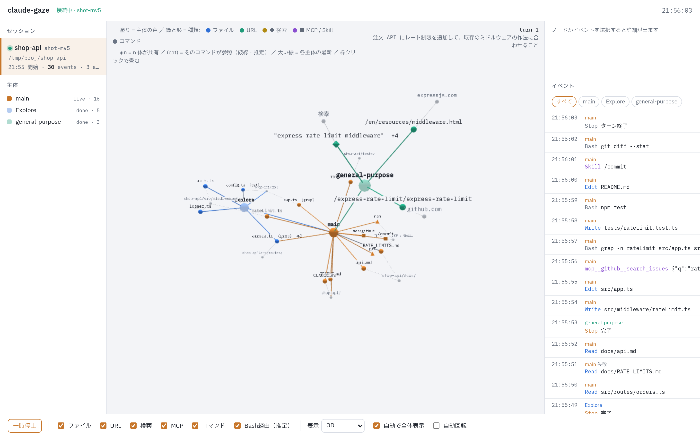
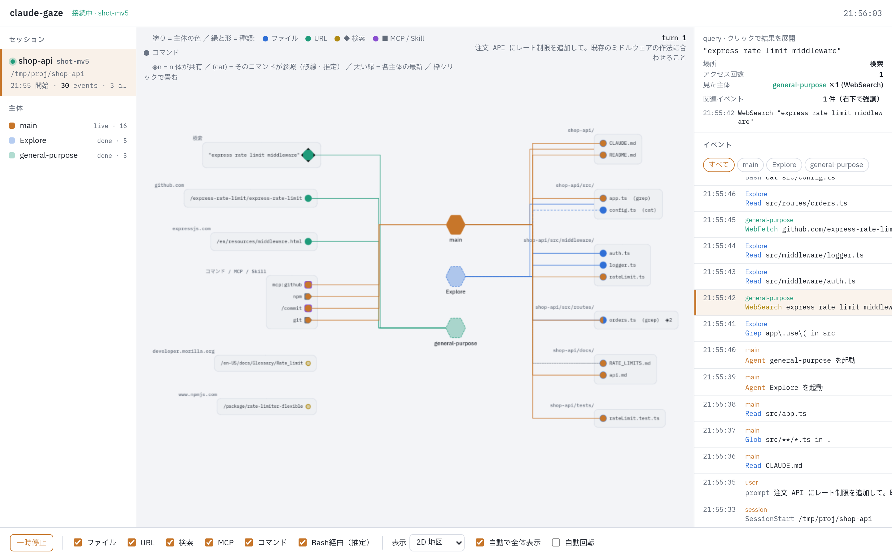

# claude-gaze

Claude Code が **いま何を見ているか** を、ブラウザにライブで描くローカルツールです。
メイン／サブエージェントごとに色を分け、ファイル・URL・検索・MCP・コマンドへのアクセスをノードと線で表示します。



- **ライブ**: Claude Code の Hooks から届いたイベントを、数ミリ秒後にブラウザへ描きます（実測 4〜5 ms）
- **主体ごとの色**: メインとサブエージェント（Explore, general-purpose など）を同時に表示し、同じファイルを複数が触ればパイ状に塗ります
- **ファイル以外も**: WebFetch の URL、WebSearch のクエリと結果 URL、MCP ツール、Skill、Bash コマンドも対象です
- **Bash 経由の推定**: `cat` `sed` `grep` などでシェル経由に触ったファイルも、コマンド文字列から推定して破線で描きます
- **失敗も描く**: 存在しないファイルの Read など失敗した呼び出しは灰色の点線で残します
- **3 つの表示**: 2D 地図／2D 主体別／3D（three.js）。切り替えても受信済みのイベントは保持します
- **外部に送らない**: Hooks は `127.0.0.1` のサーバに POST するだけで、データはメモリに置くだけです（サーバを止めると消えます）

## 仕組み

```
Claude Code ──(Hooks: PostToolUse など 8 イベント)──▶ curl ──▶ サーバ 127.0.0.1:4820 ──(SSE)──▶ ブラウザ
   メイン／サブエージェント                                       Node.js          src/web/ (Cytoscape / three.js)
```

Claude Code はツールを使うたびに Hooks の JSON（ツール名・入力・結果・agent_id など）を標準入力でコマンドに渡します。
claude-gaze はそれを `curl` で受信サーバへ送り、サーバがブラウザへ Server-Sent Events で流し、ブラウザ側の純関数 `src/web/events.js` が JSON をグラフ操作に変換します。
Hooks は `async` かつ 1 秒で諦める設定なので、サーバが動いていなくても Claude Code は遅くなりません。

## 導入

要件: Node.js 23.6 以上（TypeScript をそのまま実行するため）、`curl`、Claude Code。
Linux と macOS で動きます。Windows は未検証です（Hooks のコマンドが `sh` 構文のため、WSL を推奨）。

```sh
git clone https://github.com/NeoSolleil/claude-gaze.git
cd claude-gaze
npm install
npm run hooks:install   # ~/.claude/settings.json に Hooks を書き足す（既存の設定は残す。元のファイルは settings.json.bak）
npm start               # http://127.0.0.1:4820/ を開く
```

そのあと **新しく** Claude Code を起動して何か作業させると、ブラウザの左にセッションが現れます。
Hooks は起動時に読まれるため、すでに開いているセッションには効きません。

やめるとき:

```sh
npm run hooks:remove    # claude-gaze 由来の Hooks だけを外す
```

### 導入スクリプトの選択肢

| コマンド | 効果 |
|---|---|
| `node scripts/install-hooks.mjs` | `~/.claude/settings.json` に追加。全プロジェクトで有効 |
| `node scripts/install-hooks.mjs --project` | 今いるディレクトリの `.claude/settings.json` に追加。そのプロジェクトだけ |
| `node scripts/install-hooks.mjs --port 4821` | 別のポートで受ける（サーバは `GAZE_PORT=4821 npm start`） |
| `node scripts/install-hooks.mjs --print` | 追記する JSON を表示するだけ。手で写す人向け（`hooks/hooks.snippet.json` と同じ内容） |
| `node scripts/install-hooks.mjs --dry-run` | 書き込まずに結果を表示 |

手で入れる場合は `hooks/hooks.snippet.json` の内容を `~/.claude/settings.json` の `hooks` に足してください。
登録するイベントは PostToolUse, PostToolUseFailure, SubagentStart, SubagentStop, UserPromptSubmit, Stop, SessionStart, SessionEnd の 8 つで、どれも同じ `curl` コマンドです。

## 使い方

### 1. 起動の順番

1. ターミナルを 1 つ開き、`npm start` でサーバを起動して、そのまま置いておきます
2. ブラウザで `http://127.0.0.1:4820/` を開きます。まだ何も届いていないので「サーバ未接続」のあと「接続中 · セッション待ち」になります
3. 別のターミナルで、いつものプロジェクトに移って Claude Code を起動し、作業を頼みます

Hooks は Claude Code の起動時に読まれます。`npm run hooks:install` のあとに起動した Claude Code だけが対象です。
サーバは先に動いていなくても構いません。Hook は 1 秒で諦めるので、サーバを後から起動したときは、それ以降のイベントだけが届きます。

### 2. セッションを選ぶ

左の一覧に、イベントが届いたセッションがプロジェクト名（cwd の末尾）付きで並びます。最新が上で、クリックで切り替えます。
複数の Claude Code を動かしていると、その数だけ並びます。claude-gaze 自身のディレクトリで Claude Code を使った場合もここに出ます。
一覧の表示は `#<セッション ID の先頭数文字>` を URL に付けても指定できます。

### 3. 作業中に見るもの


- **主体ノードの 2 行目**がいまの動作です（`Read src/app.ts` など）。待機中は 2 行目が消えます
- **太い線**が各主体の最新 1 件です。次のイベントが来ると移ります。古い線は細くなるだけで消えません
- **サブエージェントが起動**すると主体が増えて別の色になり、終わると縁が破線になります
- **検索**は菱形で、結果数が `+4` のように付きます。実際に読んだ URL は WebFetch として丸で出ます
- **右のイベント列**は新しいものが上です。地図で分からないときはここを読みます

### 4. 気になったところを調べる



- **ノードをクリック**: 誰が何回、どのツールで触ったかが右上に出ます。関係するイベント行に印が付き、同時に触れた対象が点灯します
- **イベント行をクリック**: Hooks から届いた JSON をそのまま表示します。ツールの入力と結果の生データを見たいときに使います
- **主体タブ**: イベント列をその主体だけにし、地図では他の主体を灰色にします
- **枠をクリック**: ディレクトリやドメインの枠を畳みます。要素が増えて縦に長くなったときに使います
- **「Bash経由（推定）」を外す**: `cat` や `grep` から推定した破線を隠します。推定が外れていると思ったときに使います

選択は時間が経っても消えません。別のものをクリックすると移り、地図の空白をクリックすると消えます。

### 5. 一時停止と遡り

流れが速くて追えないときは下部の「一時停止」を押します。描画だけが止まり、Claude Code には影響しません。
停止中に届いたイベントは件数が表示され、「再生」で溜めた分が順に描かれます。

### 6. 終わるとき

- サーバは Ctrl+C で止めます。データはメモリにしか無いので、止めると消えます
- Hooks は入れたままで害はありません。サーバが無ければ各 Hook は 1 秒で諦め、Claude Code は遅くなりません
- 外すときは `npm run hooks:remove` です。claude-gaze 由来の項目だけを削除します

### よくある使い方

- **サブエージェントが何を読んだか確かめる**: Explore などの主体タブを押すと、その主体が触ったファイルだけが色付きで残ります。メインには見えない読み取りがここで分かります
- **検索結果のどれを実際に読んだか見る**: 菱形の検索クエリをクリックして結果 URL を展開し、同じドメインの枠で、主体から線が引かれている丸が WebFetch で実際に読んだ URL です。線の無い薄い色の丸は検索で出ただけで読んでいません
- **存在しないファイルを探し回っていないか見る**: 灰色の点線が失敗した呼び出しです。同じディレクトリに点線が続くなら、Claude Code が無いファイルを当てずっぽうで読もうとしています

## 画面の見方

### 2D 地図（既定）

- **左列**: Web ドメインごとの URL、検索クエリ（菱形）、コマンド／MCP／Skill
- **中央**: 主体（メインとサブエージェント）。2 行目に最新の動作（`Read src/app.ts` など）。待機中は 2 行目なし
- **右列**: ディレクトリごとのファイル枠。1 ファイル 1 ノードで、塗りが触った主体の色。複数ならパイ
- **線**: 主体の色。破線は Bash からの推定、灰色の点線は失敗した呼び出し。主体ごとの最新 1 件は太く描く
- **枠**: クリックで畳む／開く。畳むと `(5)` のように要素数を出す

### 2D 主体別



主体ごとの帯に分けます。同じ対象は帯ごとに出し、`◈n` で共有している主体の数を示します。「誰が何を見たか」を主体単位で追うときに使います。

### 3D



力学配置の立体表示です。ディレクトリ／ドメインは灰色のハブで、ファイルが細線でぶら下がって塊になり、粒子が主体から対象へ流れます。
左ドラッグで回転、右ドラッグで移動、ホイールで拡大縮小、「自動回転」でゆっくり回り続けます。見せる用途向けで、ライブラリ（1.3 MB）は 3D を選んだときだけ読み込みます。

### 右ペインと操作


- **ノードをクリック**: 詳細（パス、触った主体と回数、ツール）と、そのノードに関係するイベント行に印。同時に触れた対象も点灯
- **イベント行をクリック**: Hooks から届いた JSON をそのまま表示
- **検索クエリをクリック**: 結果 URL を展開（ドメインごとの枠に入る）
- **主体タブ**: イベント列を主体で絞り込み。地図側は他の主体を灰色にする
- **選択は時間で消えない**: 別のものをクリックすると移り、空白をクリックすると消える



### 下部のコントロール

| 項目 | 意味 |
|---|---|
| 一時停止 | 描画の進行だけ止める。Claude Code には影響しない。停止中のイベントは溜めて再開時に順に描く |
| ファイル／URL／検索／MCP／コマンド | 種類ごとの表示切替。「ファイル」を外すと Bash経由（推定）も隠れる |
| Bash経由（推定） | シェル経由で触ったファイル（破線）の表示切替 |
| 表示 | 2D 地図／2D 主体別／3D |
| 自動で全体表示 | 新しいノードが画面外に出たら全体を収める。直前 6 秒に操作したときと、何かを選択中は動かない |

各項目にマウスを載せると説明が出ます。

### URL パラメータ

| パラメータ | 意味 |
|---|---|
| `#<セッション ID の先頭>` | そのセッションを選ぶ（例 `#8cf6`） |
| `?view=map` `?view=lanes` `?view=3d` | 初期表示 |
| `?static=1` | SSE を使わず 1 回の取得で描く。スクリーンショット用 |

## 何がどう描かれるか

| Claude Code のツール | 描き方 |
|---|---|
| Read / Edit / Write / MultiEdit / NotebookEdit | ファイルノード（ディレクトリ枠の中） |
| Glob / Grep | 対象ディレクトリの枠を点灯。ファイルは作らない |
| Bash | コマンド文字列から実在ファイルを推定して破線で結ぶ。推定できなければコマンド名のノード（`npm`, `git` など） |
| WebFetch | URL ノード（ドメイン枠の中） |
| WebSearch | クエリ（菱形）。クリックで結果 URL を展開 |
| `mcp__<server>__<tool>` | MCP サーバごとのノード |
| Skill | `/<name>` のノード |
| 上記以外（Agent, AskUserQuestion, ToolSearch など） | 描かない |
| SubagentStart / SubagentStop | 主体の出現と終了（終了した主体は破線の縁と薄い塗り） |
| UserPromptSubmit / Stop | ターン番号と文頭を右上に表示。メインの「待機中」 |
| PostToolUseFailure | 灰色の点線、イベント行に「失敗」 |

## 制限と注意

- **色で区別できる主体は 6 体まで**。7 体目からは色が循環します
- **Bash の推定は文字列ベース**です。`cat`, `sed`, `grep` のようにファイル名を引数に取るコマンドは拾えますが、`npm run dev` や `curl` のようにファイルを読まないコマンドは拾いません（過去ログ 45 件で検出 15 件。未検出の大半はファイルを読まないコマンドでした）。推定が外れた線は「Bash経由（推定）」で隠せます
- **`Agent` ツールの呼び出し自体は行に出ません**。サブエージェントの起動は SubagentStart で描きます
- **claude-gaze を触っているセッションも一覧に出ます**。Hooks はプロジェクトを選ばないためです
- **データはメモリのみ**。サーバを再起動すると消えます。セッションあたり 5,000 件で古いものから捨てます
- **Hooks の JSON 形式は Claude Code の内部仕様**で、リリースによって変わりえます。WebSearch の結果 URL 抽出は形式が変わると空になります（クエリノードは残ります）
- **サーバは 127.0.0.1 のみ**で待ち受けます。他のマシンからは見えません

## トラブルシュート

| 症状 | 確認すること |
|---|---|
| セッションが現れない | Hooks を入れた**あと**に起動した Claude Code か。`claude` の `/hooks` で PostToolUse に `curl ... 127.0.0.1:4820/hook` が載っているか。`npm start` が動いているか |
| 「ポート 4820 は使用中」で起動できない | 既に claude-gaze が動いています。そのまま使うか、`GAZE_PORT=4821 npm start` と `node scripts/install-hooks.mjs --port 4821` でポートを揃える |
| 「サーバ未接続」と出る | ブラウザが SSE を張れていません。`npm start` の出力と、URL が `http://127.0.0.1:4820/` か確認 |
| ファイルが右列に出ず「コマンド」に `cat` が出る | 推定できなかった Bash です。cwd 基準で実在するファイルだけを拾います |
| 3D が真っ黒 | WebGL が無効なブラウザ。2D を使ってください |

動作確認だけしたいときは、サーバを起動した状態で架空セッションを投入できます。

```sh
sh scripts/demo-session.sh     # 主体 3 体、失敗・検索・MCP・Skill・Bash 推定を含む
```

## 開発

```sh
npm test                     # events.js（Hooks JSON → グラフ操作）と導入スクリプトの単体テスト
npx tsc -p tsconfig.json     # サーバの型検査
node scripts/measure-guess.mjs <session.jsonl> <cwd>   # 過去のセッションログで Bash 推定の検出率を測る
```

```
src/server/   main.ts（HTTP と SSE）, hooks.ts（Hooks の型と検証）, store.ts（セッション別保持と Bash 推定）, sse.ts
src/web/      events.js（純関数）, model.js, ui.js, graph2d.js（Cytoscape）, graph3d.js（3d-force-graph）, live.js（SSE と表示切替）
scripts/      install-hooks.mjs, demo-session.sh, measure-guess.mjs
hooks/        hooks.snippet.json（手で写す人向け）
docs/         concept.md（構想と調査結果）, images/
mock/         実装前の UI モック（2D, 3D）
```

設計の経緯と、Hooks・セッションログを調べて分かったことは [docs/concept.md](docs/concept.md) にあります。

## ライセンス

MIT
